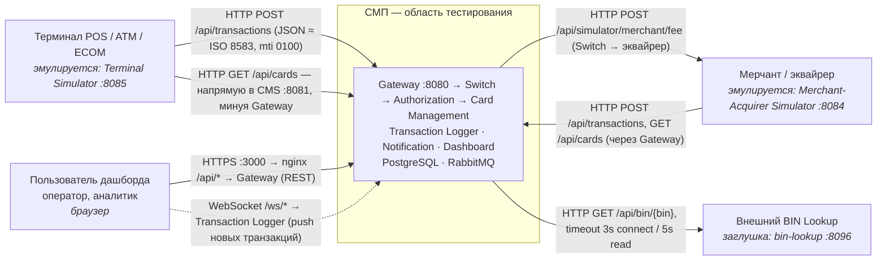

# А1. C4 Level 1 — Context

## Диаграмма

Обозначения: сплошная линия — синхронный запрос-ответ (HTTP), пунктир — асинхронный push (WebSocket).

## Акторы и протоколы

| Актор | Направление | Протокол / эндпоинт | Подтверждение кодом |
|---|---|---|---|
| Терминал | → СМП | `POST {GATEWAY_URL}/api/transactions` | [`terminal-simulator/.../client/GatewayClient.java`](../../../services/terminal-simulator/src/main/java/com/processing/terminalsimulator/client/GatewayClient.java) (`post().uri(gatewayUrl + "/api/transactions")`) |
| Терминал | → СМП (CMS) | `GET {CARD_MGMT_URL}/api/cards` — **не через Gateway** | тот же `GatewayClient` (`cardManagementUrl + "/api/cards"`), [`docker-compose.yaml`](../../../docker-compose.yaml) `CARD_MGMT_URL=http://card-management:8080` |
| Мерчант / эквайрер | → СМП | `POST /api/transactions`, `GET /api/cards` через Gateway | [`merchant-acquirer/.../client/GatewayClient.java`](../../../services/merchant-acquirer/src/main/java/com/processing/merchantacquirer/client/GatewayClient.java) |
| Мерчант / эквайрер | ← СМП | `POST /api/simulator/merchant/fee` — Switch запрашивает комиссию | [`switch/.../service/MerchantAcquirerClient.java`](../../../services/switch/src/main/java/com/processing/service/MerchantAcquirerClient.java), [`SimulationController.java`](../../../services/merchant-acquirer/src/main/java/com/processing/merchantacquirer/controller/SimulationController.java) |
| Пользователь дашборда | → СМП | браузер → nginx `:3000`: `/api/` → Gateway, `/ws/` → Logger | [`dashboard/nginx.conf`](../../../services/dashboard/nginx.conf), [`dashboard/src/hooks/useWebSocket.ts`](../../../services/dashboard/src/hooks/useWebSocket.ts) |
| Внешний BIN Lookup | ← СМП | `GET /api/bin/{bin}`; есть «рычаги» `?delay=` и `?fail=true` | [`authorization/.../client/BinLookupClient.java`](../../../services/authorization/src/main/java/com/processing/authorization/client/BinLookupClient.java), [`BinLookupController.java`](../../../services/bin-lookup/src/main/java/com/processing/binlookup/controller/BinLookupController.java) |
