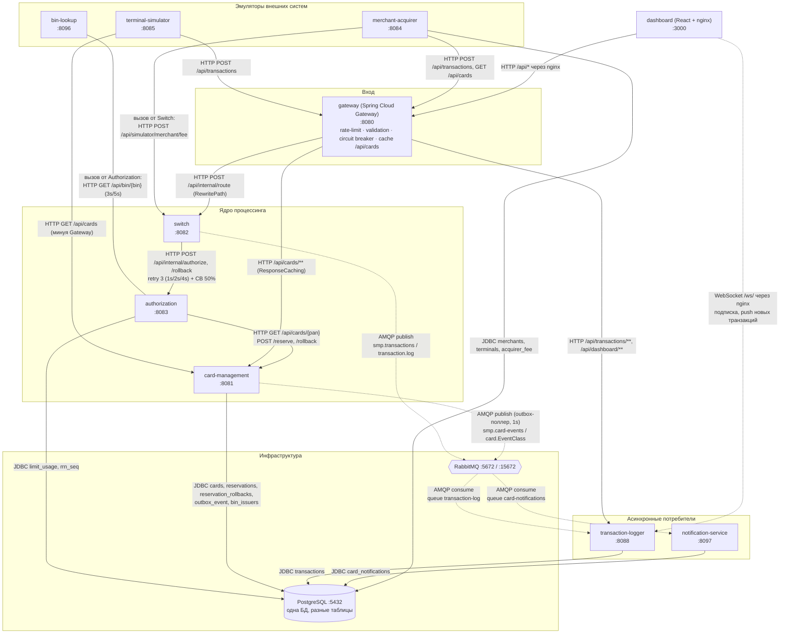

# А2. C4 Level 2 — Container

Каждая стрелка размечена:

- **сплошная `-->`** — синхронно: HTTP (REST) или JDBC;
- **пунктир `-.->`** — асинхронно: AMQP (exchange / routing key) или WebSocket-push.

## Диаграмма

Вызовы из ядра во внешние системы (Switch → merchant-acquirer, Authorization → bin-lookup) нарисованы линией без наконечника. Маршруты Gateway `/api/simulator/**` в симуляторы на схеме не показаны.

## Таблица связей (точки сочленения)

Каждая строка — точка сочленения: потенциальная точка отказа и кандидат в тест.

| # | Откуда → куда | Тип | Детали | Подтверждение кодом | Чем тестировать |
|---|---|---|---|---|---|
| C1 | Gateway → Switch | sync HTTP | `/api/transactions` → `/api/internal/route` | [`gateway/application.yml`](../../../services/gateway/src/main/resources/application.yml), [`RouteController.java`](../../../services/switch/src/main/java/com/processing/controller/RouteController.java) | API (контракт) |
| C2 | Switch → Authorization | sync HTTP | `POST /api/internal/authorize`; Resilience4j retry 3 + circuit breaker | [`AuthorizationClient.java`](../../../services/switch/src/main/java/com/processing/service/AuthorizationClient.java), [`switch/application.yml`](../../../services/switch/src/main/resources/application.yml) | API |
| C3 | Switch → Authorization | sync HTTP | `POST /api/internal/rollback` (reversal) | `AuthorizationClient.rollback` | интеграционный |
| C4 | Switch → Merchant-Acquirer | sync HTTP | `/api/simulator/merchant/fee`; при ошибке `null` | [`MerchantAcquirerClient.java`](../../../services/switch/src/main/java/com/processing/service/MerchantAcquirerClient.java) | API |
| C5 | Authorization → CMS | sync HTTP | `GET /api/cards/{pan}`, `POST /reserve`, `POST /rollback`; статусы 400/402/404/409/500/503 маппятся в исключения | [`CardManagementClientImpl.java`](../../../services/authorization/src/main/java/com/processing/authorization/client/CardManagementClientImpl.java) | API |
| C6 | Authorization → BIN Lookup | sync HTTP | таймауты 3s / 5s, при ошибке `Optional.empty()` | [`BinLookupClient.java`](../../../services/authorization/src/main/java/com/processing/authorization/client/BinLookupClient.java) | API |
| C7 | Authorization → PostgreSQL | sync JDBC | native `INSERT … ON CONFLICT` в `limit_usage` | [`LimitUsageRepository.java`](../../../services/authorization/src/main/java/com/processing/authorization/repositories/LimitUsageRepository.java) | интеграционный (Testcontainers PG) |
| C8 | CMS → PostgreSQL | sync JDBC | `SELECT … FOR UPDATE` (`findWithPessimisticLockByPan`), soft delete через `@SQLRestriction` | [`CardRepositoryPersistenceAdapter.java`](../../../services/card-management/src/main/java/com/processing/cardmanagement/repositories/CardRepositoryPersistenceAdapter.java), [`CardEntity.java`](../../../services/card-management/src/main/java/com/processing/cardmanagement/models/CardEntity.java) | интеграционный |
| C9 | Switch → RabbitMQ → Logger | **async AMQP** | `smp.transactions` → `transaction-log` → `@RabbitListener` | [`LoggerClient.java`](../../../services/switch/src/main/java/com/processing/service/LoggerClient.java), [`TransactionLogListener.java`](../../../services/transaction-logger/src/main/java/com/processing/transactionlogger/listener/TransactionLogListener.java) | интеграционный (eventual consistency) |
| C10 | CMS (outbox) → RabbitMQ → Notification | **async AMQP** | `outbox_event` → поллер → `smp.card-events` → `card-notifications` | [`OutboxProcessor.java`](../../../services/card-management/src/main/java/com/processing/cardmanagement/services/OutboxProcessor.java), [`CardEventListener.java`](../../../services/notification-service/src/main/java/com/processing/notification/listener/CardEventListener.java) | интеграционный |
| C11 | Dashboard ↔ Logger | async WebSocket | браузер открывает соединение `/ws/`, Logger шлёт broadcast после сохранения | [`TransactionService.java`](../../../services/transaction-logger/src/main/java/com/processing/transactionlogger/service/TransactionService.java) (`webSocketManager.broadcast`) | интеграционный / UI |
| C12 | Gateway → CMS | sync HTTP | `/api/cards/**` с фильтром `ResponseCaching` | [`ResponseCachingGatewayFilterFactory.java`](../../../services/gateway/src/main/java/com/processing/gateway/caching/ResponseCachingGatewayFilterFactory.java) | API: кэш очищается только не-GET запросом **через Gateway**, а `reserve` и `rollback` идут Authorization → CMS напрямую. Поэтому `GET /api/cards/{pan}` через Gateway после транзакции может вернуть **старый баланс** |
