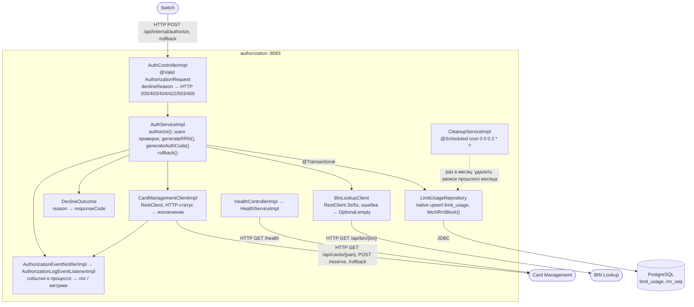
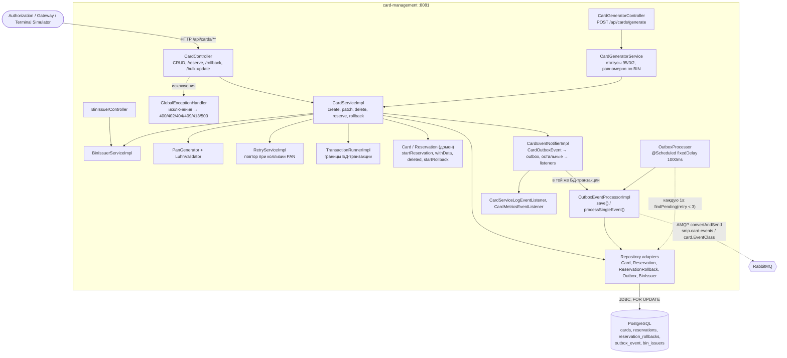

# А3. C4 Level 3 — Component (Authorization, Card Management)

Обозначения на схемах: сплошная линия — синхронный вызов в процессе, HTTP или JDBC; пунктир — асинхронный (`@Scheduled`, AMQP).

---

## 1. Authorization Service

---

## 2. Card Management Service

