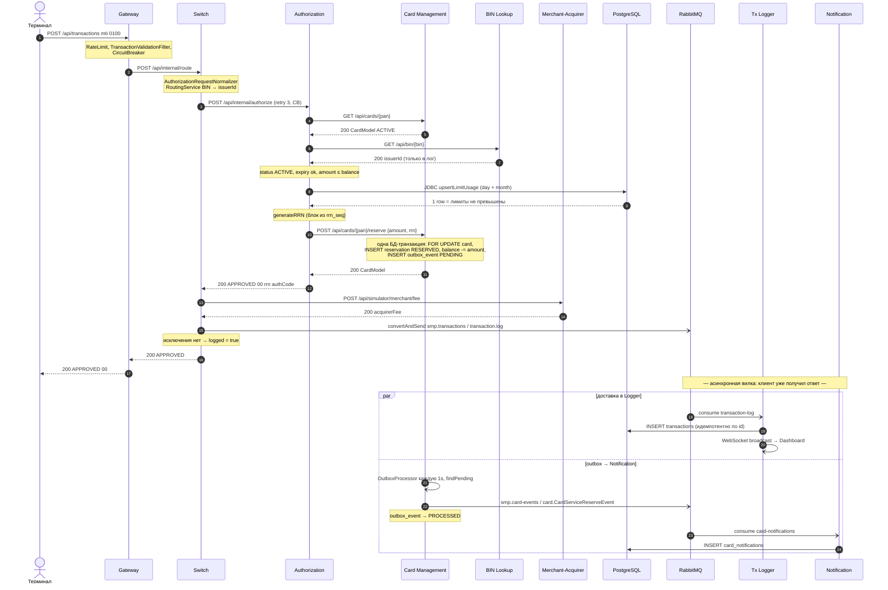
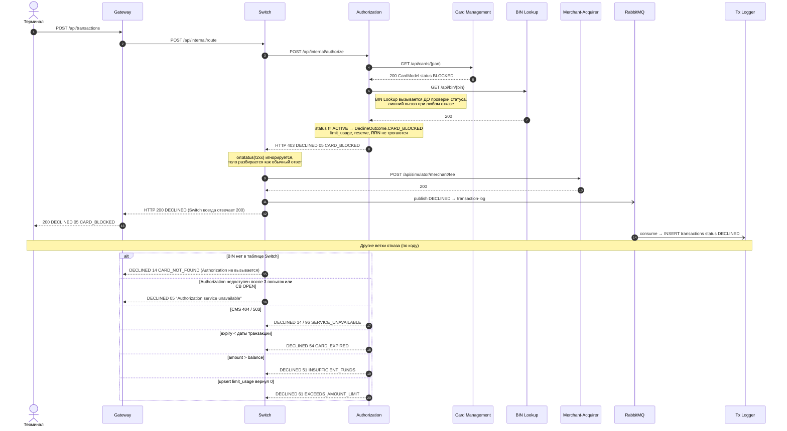
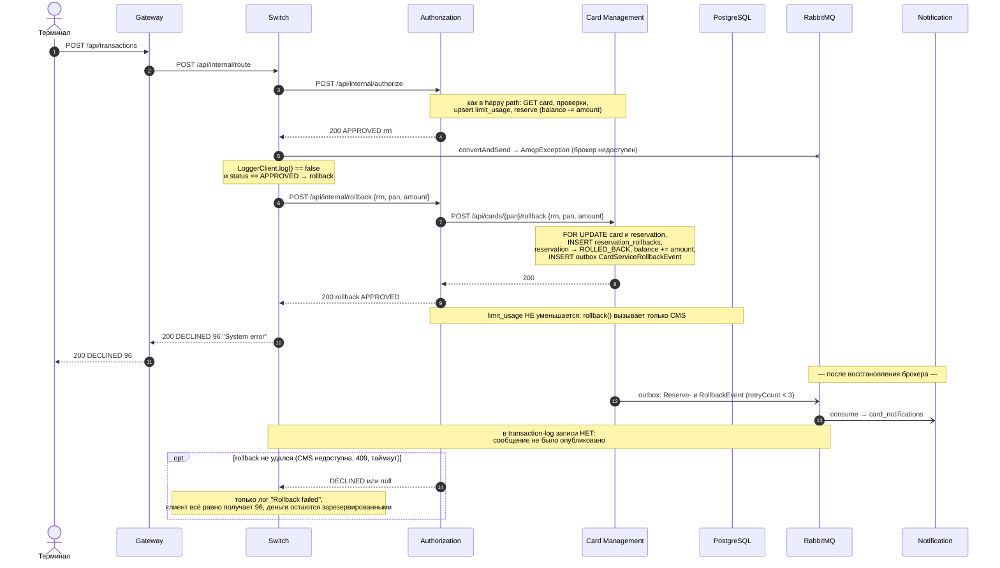

# А4. Sequence — путь транзакции: happy path, declined, reversal

Обозначения: `->>` — синхронный запрос, `-->>` — синхронный ответ, `-)` — асинхронная отправка (AMQP, WebSocket, `@Scheduled`).

---

## 1. Happy path — APPROVED

---

## 2. Declined — карта BLOCKED

---

## 3. Reversal — сбой публикации в RabbitMQ после APPROVED

