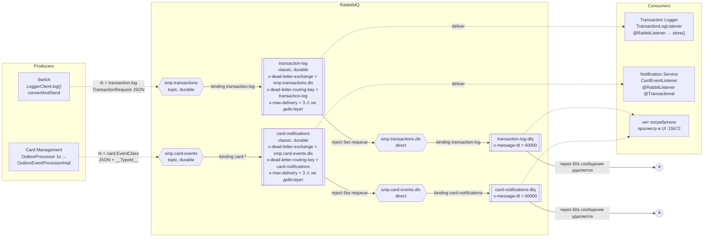
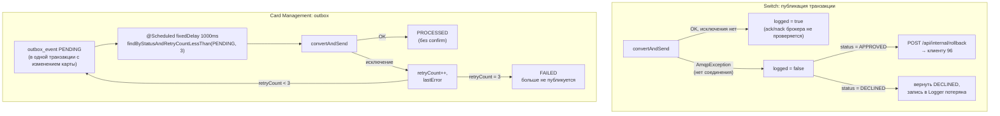

# А5. RabbitMQ-топология

## Диаграмма

## Механика

### Publisher side

### Consumer side: судьба сообщения при ошибке

| Ситуация | Что делает Spring AMQP при текущих настройках | Куда попадает сообщение |
|---|---|---|
| Logger: тело не десериализуется в `TransactionRequest` | `MessageConversionException` считается фатальной → reject, `requeue=false` | DLX → `transaction-log-dlq`, живёт 60s |
| Logger: `store()` бросил исключение (БД недоступна, `TransactionConflictException`) | `defaultRequeueRejected = true` → nack с requeue | обратно в `transaction-log` → **бесконечная повторная доставка** (лимит 3 не работает) |
| Notification: невалидный JSON или ошибка БД | listener сам ловит исключение и бросает `RuntimeException` → requeue | обратно в `card-notifications` → бесконечная повторная доставка |
| Сообщение в DLQ дольше 60s | истёк TTL; у DLQ своего DLX нет | **удаляется безвозвратно** |

## Подтверждение кодом

| Элемент | Файл |
|---|---|
| `smp.transactions`, `transaction-log`, DLX/DLQ, TTL 60 000 | [`switch/.../config/RabbitMQConfig.java`](../../../services/switch/src/main/java/com/processing/config/RabbitMQConfig.java) |
| Объявление очереди на стороне Logger (без DLX/DLQ) | [`transaction-logger/.../config/RabbitMQConfig.java`](../../../services/transaction-logger/src/main/java/com/processing/transactionlogger/config/RabbitMQConfig.java) |
| Публикация, `AmqpException` → `false` | [`LoggerClient.java`](../../../services/switch/src/main/java/com/processing/service/LoggerClient.java) |
| Rollback при `!logged && APPROVED` | [`RouteService.java`](../../../services/switch/src/main/java/com/processing/service/RouteService.java) |
| `publisher-confirm-type: correlated` | [`switch/application.yml`](../../../services/switch/src/main/resources/application.yml), [`card-management/application.properties`](../../../services/card-management/src/main/resources/application.properties) |
| `smp.card-events`, `card-notifications`, binding `card.*`, DLX/DLQ | [`card-management/.../config/RabbitMQConfig.java`](../../../services/card-management/src/main/java/com/processing/cardmanagement/config/RabbitMQConfig.java), [`notification-service/.../config/RabbitMQConfig.java`](../../../services/notification-service/src/main/java/com/processing/notification/config/RabbitMQConfig.java) |
| Outbox: поллер, retry, FAILED | [`OutboxProcessor.java`](../../../services/card-management/src/main/java/com/processing/cardmanagement/services/OutboxProcessor.java), [`OutboxEventProcessorImpl.java`](../../../services/card-management/src/main/java/com/processing/cardmanagement/services/OutboxEventProcessorImpl.java), [`OutboxEventDataStatus.java`](../../../services/card-management/src/main/java/com/processing/cardmanagement/models/OutboxEventDataStatus.java) |
| Consumers | [`TransactionLogListener.java`](../../../services/transaction-logger/src/main/java/com/processing/transactionlogger/listener/TransactionLogListener.java), [`CardEventListener.java`](../../../services/notification-service/src/main/java/com/processing/notification/listener/CardEventListener.java) |
| Идемпотентность Logger по `id` | [`TransactionService.store`](../../../services/transaction-logger/src/main/java/com/processing/transactionlogger/service/TransactionService.java) |
