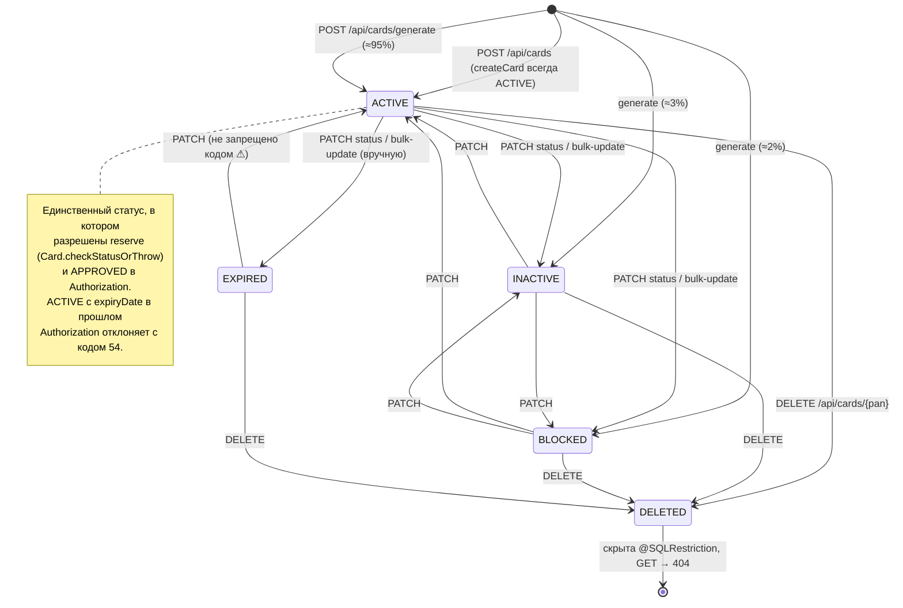
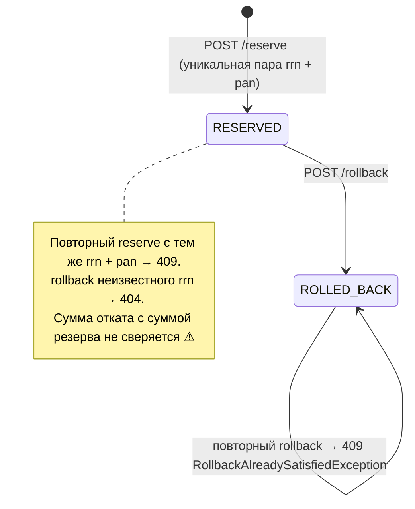
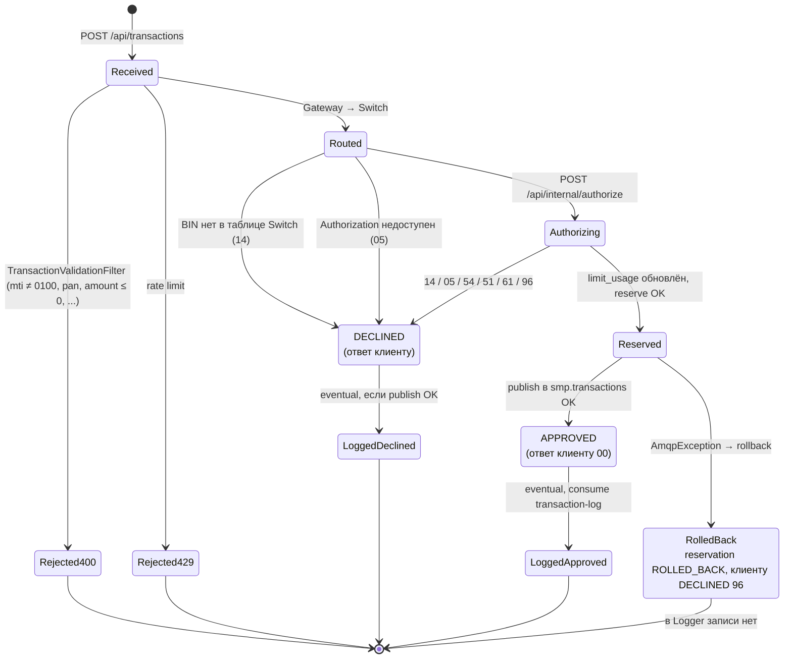

# А6. State-transition: `Card.status` и жизненный цикл транзакции

---

## 1. `Card.status` (Card Management)

### Реакция системы на каждый статус

| Статус | `GET /api/cards/{pan}` | Авторизация (Authorization) | `POST /reserve` напрямую в CMS |
|---|---|---|---|
| `ACTIVE` | 200 | дальше идут проверки срока, баланса и лимитов | 200 или 402 (баланс) |
| `INACTIVE` | 200 | DECLINED **05** `CARD_INACTIVE`, HTTP 403 | 409 (`IllegalStateException`) |
| `BLOCKED` | 200 | DECLINED **05** `CARD_BLOCKED`, HTTP 403 | 409 |
| `EXPIRED` | 200 | DECLINED **54** `CARD_EXPIRED`, HTTP 403 | 409 |
| `DELETED` | **404** | CMS 404 → DECLINED **14** `CARD_NOT_FOUND` | 404 |

### Таблица переходов → тест-кейсы

Для state-transition покрываем все **валидные** переходы, хотя бы один **невалидный** и реакцию в каждом состоянии.

| Из | Событие | В | Ожидаемо по коду | Замечание | ТК |
|---|---|---|---|---|---|
| — | `POST /api/cards` | ACTIVE | 201 | | TC-CMS-02 |
| ACTIVE | PATCH `BLOCKED` | BLOCKED | 200, следующая авторизация 05 | | TC-CMS-21, TC-P3-11, TC-P3-18 |
| BLOCKED | PATCH `ACTIVE` | ACTIVE | 200, авторизация снова возможна | | TC-P3-11 |
| ACTIVE | PATCH `INACTIVE` | INACTIVE | 200 | | TC-AUTH-04 |
| EXPIRED | PATCH `ACTIVE` | ACTIVE | 200 | ⚠ «оживление» истёкшей карты не запрещено; при старом `expiryDate` Authorization всё равно вернёт 54 | TC-P3-11 |
| любой | `DELETE` | DELETED | 204 | | TC-CMS-23 |
| DELETED | `DELETE` повторно | — | **404** (а не 409) | `@SQLRestriction` скрывает строку | TC-P3-11 |
| любой | PATCH `status = DELETED` | — | по контракту **400**: значения нет в `CardModelStatus` | невалидный переход. По коду, вероятно, **500**: `HttpMessageNotReadableException` перехватывает общий `@ExceptionHandler(Exception.class)` в `GlobalExceptionHandler` | TC-P3-11 |
| BLOCKED | `POST /reserve` | — | 409, баланс не изменился | | TC-P3-06, TC-P3-11 |
| ACTIVE с прошлым `expiryDate` | авторизация | — | 54 | автоматического перехода в EXPIRED нет | TC-AUTH-07, TC-P3-02 |

---

## 2. `Reservation.status` (Card Management)

---

## 3. Жизненный цикл транзакции (сквозной)

Хранимые статусы по сервисам:

| Где хранится | Значения | Файл |
|---|---|---|
| Transaction Logger, `transactions.status` | `APPROVED`, `DECLINED` | [`TransactionStatus.java`](../../../services/common/src/main/java/com/processing/common/dto/transactionlogger/TransactionStatus.java) |
| CMS, `reservations.status` | `RESERVED`, `ROLLED_BACK` | [`ReservationStatus.java`](../../../services/card-management/src/main/java/com/processing/cardmanagement/models/ReservationStatus.java), [`Reservation.java`](../../../services/card-management/src/main/java/com/processing/cardmanagement/models/Reservation.java) |
| CMS, `outbox_event.status` | `PENDING`, `PROCESSED`, `FAILED` | [`OutboxEventDataStatus.java`](../../../services/card-management/src/main/java/com/processing/cardmanagement/models/OutboxEventDataStatus.java) |
| Ответ клиенту | `APPROVED` / `DECLINED` + `responseCode` | [`AuthorizationResponse.java`](../../../services/common/src/main/java/com/processing/common/dto/authorization/AuthorizationResponse.java) |

**Вывод для E2E.** «Транзакция ROLLED_BACK» в терминах задания — это сочетание трёх фактов:

1. клиент получил `DECLINED 96`;
2. в CMS резервирование в статусе `ROLLED_BACK`;
3. в Logger записи нет.

E2E-тест reversal должен проверять все три. Статуса транзакции, который можно было бы прочитать одним запросом, нет.

## В коде

- статусы и переходы карты: [`Card.java`](../../../services/card-management/src/main/java/com/processing/cardmanagement/models/Card.java) (`withData`, `deleted`, `checkStatusOrThrow`, `startReservation`), [`CardServiceImpl.java`](../../../services/card-management/src/main/java/com/processing/cardmanagement/services/CardServiceImpl.java) (`createCard` → `CardStatus.ACTIVE`, `patchCard`, `deleteCard`, `bulkUpdateStatus`), [`CardGeneratorService.java`](../../../services/card-management/src/main/java/com/processing/cardmanagement/services/CardGeneratorService.java) (95/3/2);
- soft delete: [`CardEntity.java`](../../../services/card-management/src/main/java/com/processing/cardmanagement/models/CardEntity.java) `@SQLRestriction("status <> 'DELETED'")`, [`CardStatusMapper.java`](../../../services/card-management/src/main/java/com/processing/cardmanagement/mappers/CardStatusMapper.java);
- реакция Authorization на статус: [`AuthServiceImpl.java`](../../../services/authorization/src/main/java/com/processing/authorization/services/AuthServiceImpl.java) (`switch (currCardStatus)`), [`DeclineOutcome.java`](../../../services/authorization/src/main/java/com/processing/authorization/constants/DeclineOutcome.java);
- жизненный цикл транзакции: [`TransactionValidationFilter.java`](../../../services/gateway/src/main/java/com/processing/gateway/validation/TransactionValidationFilter.java), [`TransactionRateLimitFilter.java`](../../../services/gateway/src/main/java/com/processing/gateway/ratelimit/TransactionRateLimitFilter.java), [`RouteService.java`](../../../services/switch/src/main/java/com/processing/service/RouteService.java).
