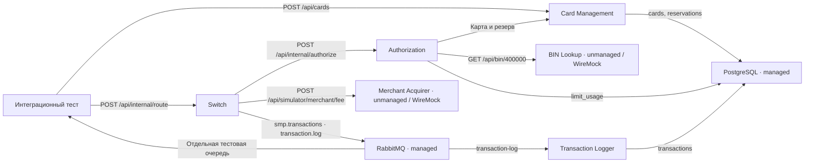

# Практика 6. Интеграционные тесты СМП

## 1. Граница уровней

Unit-тесты Authorization покрывают обработку статуса карты, маппинг причин отказа и реакцию на ошибки зависимостей. В практике 4 Mockito задавал результат вызова `upsertLimitUsage`, чтобы проверить реакцию сервиса на отказ или на повторную попытку. В `LimitUsageRepositoryIT` этот же метод исполняет реальный SQL в PostgreSQL. Тесты проверяют число изменённых строк и состояние, прочитанное из БД после завершения транзакции.

Интеграционные тесты также проверяют миграции и маппинг карт, доставку сообщения через RabbitMQ, создание резерва и запись операции в БД логгера. Для Switch проверяется один одобренный платёж и его следы в трёх БД и брокере.

### Локальный эксперимент с H2

В отдельной временной копии Card Management я прогнал те же проверки на H2 2.3.232 в режиме совместимости с PostgreSQL.

| Конфигурация H2 | Наблюдаемый результат |
| --- | --- |
| Flyway включён, `ddl-auto=validate` | Миграции дошли до V5.8. H2 отклонил `CREATE UNIQUE INDEX uk_cards_pan ON cards (pan) WHERE cards.status != 'DELETED'` с SQLState `42000`. Контекст не стартовал. |
| Flyway выключен, `ddl-auto=create-drop` | Round-trip всех полей и отказ второй активной карте прошли. Переиспользование PAN удалённой карты завершилось `PanCollisionException`. Hibernate создал обычное уникальное ограничение на PAN, которое действует и на строки со статусом `DELETED`. |

Таким образом, два успешных сценария на схеме Hibernate подтверждают базовый маппинг и уникальность PAN. Для проверки возможности переиспользования PAN и запуска реальных миграций нужна схема PostgreSQL с частичным индексом.

## 2. Persistence-checklist

| Проверка | Покрытие |
| --- | --- |
| Round-trip | `CardRepositoryIT` сверяет все поля доменной карты после повторного чтения в отдельной транзакции. |
| Ограничения целостности | `CardRepositoryIT` проверяет `PanCollisionException` для двух активных карт и сосуществование удалённой и новой активной записи с одним PAN. `LimitUsageRepositoryIT` проверяет, что повторный upsert сохраняет тот же идентификатор и одну строку на пару PAN и даты. |
| Миграции на чистой БД | `CardRepositoryIT` поднимает Flyway V5.1–V5.8 на пустом PostgreSQL с `ddl-auto=validate`. В Authorization таблицу `limit_usage` создаёт Hibernate (`ddl-auto=update`), а Flyway создаёт `rrn_seq`. Здесь проверяется совместимость JPA-сущности и SQL с PostgreSQL. |
| Диалектные запросы | `LimitUsageRepositoryIT` исполняет `INSERT … ON CONFLICT … DO UPDATE` с вычислениями по дате. Проверяются вставка, накопление ровно до дневного лимита и превышение на 0,01 с результатом `0` и сохранением состояния строки. |
| Транзакционность | Подготовка, операция и чтение результата проходят независимо. В репозиторных тестах границы задаёт `TransactionTemplate`. В сквозном тесте HTTP-вызовы фиксируют изменения в сервисах, а независимые JDBC-запросы их читают. |
| Доставка | `TransactionLogDlqIT` проверяет тело и идентификатор сообщения в DLQ, `x-death` с причиной `rejected`, ровно одну доставку слушателю и пустую основную очередь. После отправки следующего валидного сообщения проверяется запись в PostgreSQL. |

## 3. Стратегия изоляции

- Каждый класс объявляет свои статические `@Container`. В репозиторных тестах и тесте DLQ параметры Spring задаёт `@ServiceConnection`. Сквозной тест запускает четыре JAR из текущей сборки в отдельной сети Testcontainers и использует три базы на одном PostgreSQL.
- Перед каждым тестом `TRUNCATE … RESTART IDENTITY CASCADE` очищает затрагиваемые таблицы. Миграции и справочник BIN сохраняются. Перед брокерными сценариями синхронный purge очищает основную очередь и DLQ. Сквозной тест сбрасывает журнал запросов WireMock.
- Для репозиторных сценариев генерируются отдельные PAN. В сквозном тесте PAN выдаёт Card Management, STAN генерирует тест, а RRN выдаёт Authorization. Этот RRN связывает ответ Switch, резерв и запись логгера. В тесте DLQ для валидной операции генерируются отдельные PAN, STAN и RRN.
- Асинхронные проверки используют Awaitility с интервалом 100 мс и пределом 5 с. Тест DLQ читает сообщение сразу после отклонения из-за TTL 60 с. DLX и DLQ в этом тесте объявлены тестовой конфигурацией по топологии Switch.
- Валидное сообщение использует тот же формат Java-сериализации, что и Switch. Для отдельного теста логгера задан список разрешённых классов DTO и используемых типов. Битый JSON отправляется с `application/json` и отклоняется при преобразовании входного сообщения в `TransactionRequest`.

## 4. Сквозная цепочка



Точка входа Switch в этой цепочке — `POST /api/internal/route`. Switch вызывает `POST /api/internal/authorize` в Authorization. Тест проверяет `APPROVED` и публикацию в брокере. После ответа он сверяет дневное и месячное использование лимитов, сумму резерва и запись Logger с теми же RRN, STAN, PAN и комиссией из WireMock.

## 5. Запуск и самопроверка

Команду нужно выполнить из корня репозитория с JDK 21 и запущенным Docker Engine.

```bash
mvn -B -ntp -f services/pom.xml -Pintegration-tests verify
```

Профиль запускает четыре класса `*IT` через Maven Failsafe. GitHub Actions выполняет команду дважды подряд на одном runner и сохраняет отчёты из `target/failsafe-reports`.
